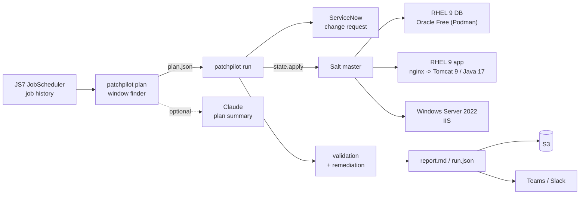
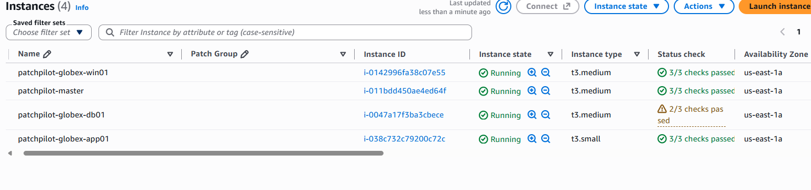
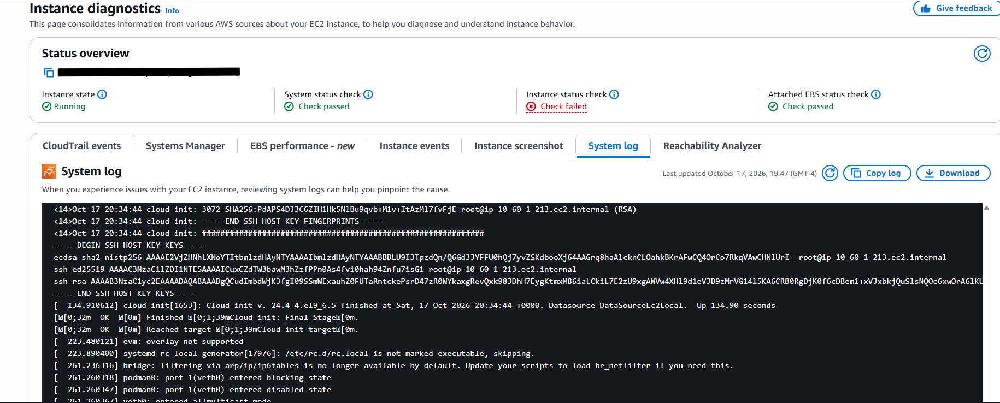
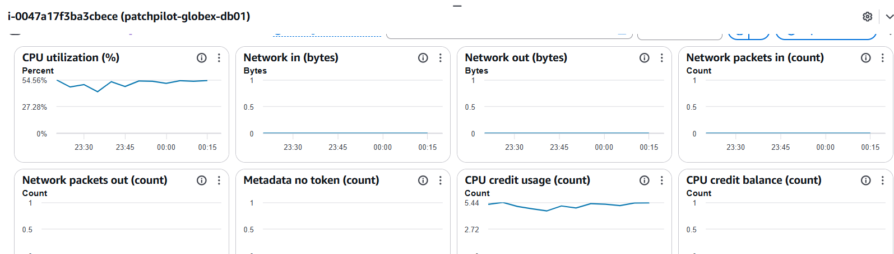
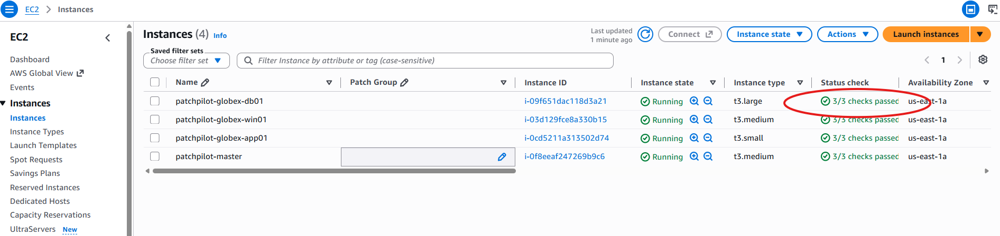
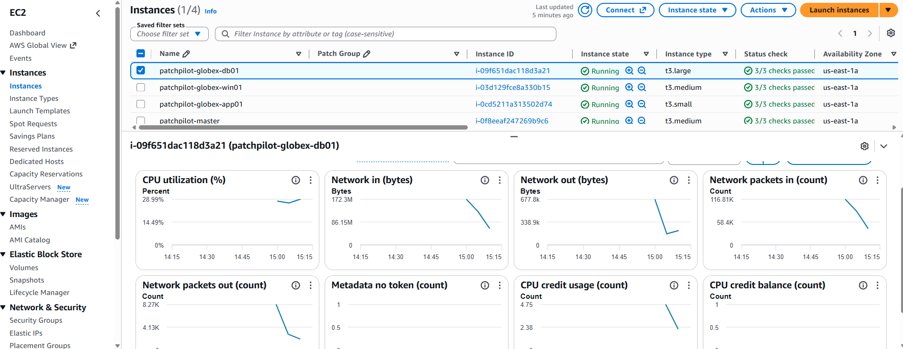
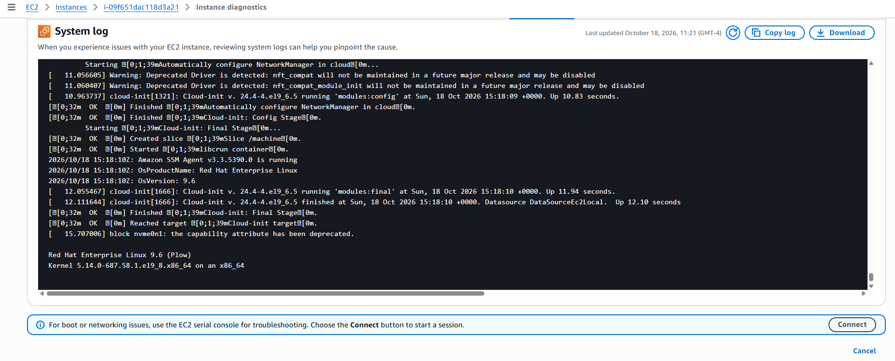
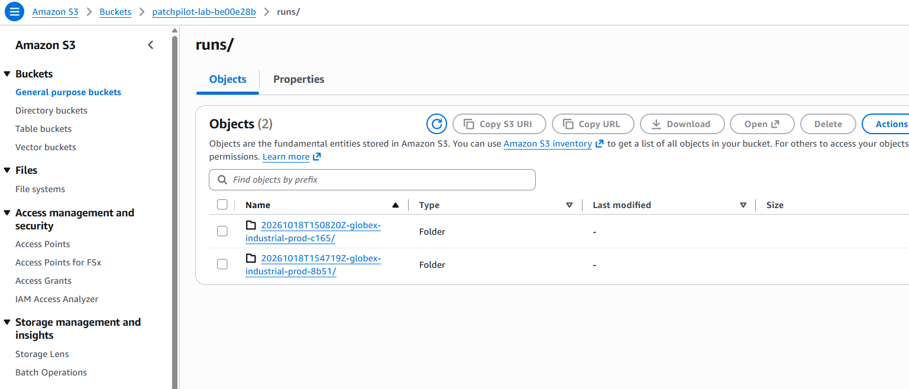
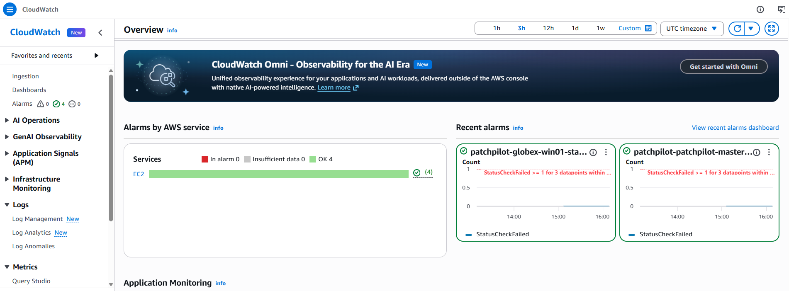

# PatchPilot: patching that schedules itself around batch workloads

Hosted enterprise apps are often patched by hand, and the hard part isn't
running `dnf upgrade`. Each customer runs heavy batch workflows (nightly ETL,
weekend re-plans, month-end close), and if a patch window overlaps one,
customers can't work the next morning even though the app is "up". So every
cycle someone re-reads every customer's job schedule, finds a gap, patches,
clicks through the app to check it, and writes it all up.

PatchPilot automates that loop:

1. **Plan:** reads job history from the scheduler (JS7 JobScheduler), learns
   each customer's batch rhythm, and finds a window that fits between the runs.
   Non-prod goes first and prod follows after a soak period. Workflows whose
   runtime is creeping up get flagged.
2. **Patch:** Salt patches the database tier, then the app tier, then the
   Windows tier, with reboots and health waits. Java and Tomcat stay on their
   certified versions.
3. **Validate:** the manual runbook as code: services, login page, a
   chart screen, SELinux state and denials, pinned versions, the Oracle
   listener, IIS, and pending reboots.
4. **Fix or escalate:** known failures get known fixes, then validation runs
   again. Anything without a fix is escalated with the evidence attached.
5. **Report:** opens and closes a ServiceNow change, compares OpenSCAP STIG
   scans from before and after, posts to Teams or Slack, and stores the report
   in S3. Optionally, Claude writes up the plan for the change review.



## Two failures it's built to catch

These are real failure modes for Java apps on RHEL. The lab reproduces both
with `--inject`.

| What happens | What PatchPilot sees | What it does |
|---|---|---|
| A patch flips SELinux from Permissive back to **Enforcing**. nginx (`httpd_t`) can no longer connect to Tomcat, so every page returns 502. | `http_login` and `http_chart` fail with 502, `selinux_mode` changed, AVC denials | Applies `httpd_can_network_connect` and **leaves SELinux Enforcing**. Turning SELinux off would also "work", but it fails the STIG. |
| Tomcat moves from the certified 9.0.x to 10.1, which is **Jakarta EE**. The login page still works, but a legacy `javax.*` screen no longer compiles. | `tomcat_version` drift and `http_chart` returns 500 | Re-pins Tomcat to the certified version (a symlink flip back) and validates again |
| A screen breaks while Tomcat *is* certified | `http_chart` fails, and no fix is known | Marks the run failed and recommends an R&D defect, with the report attached |

## Try it on a laptop (no cloud)

The `--simulate` flag swaps Salt for an in-memory model of the lab, so the
whole cycle runs anywhere Python 3.10+ does.

```bash
python -m venv .venv && . .venv/bin/activate        # Windows: .venv\Scripts\activate
pip install -e ".[dev]"

patchpilot demo-data                                 # 60 days of batch history, 3 customers
patchpilot plan                                      # windows for the cycle starting next Monday
patchpilot run --customer globex-industrial --env prod --simulate --ignore-window --scan
patchpilot run --customer globex-industrial --env prod --simulate --ignore-window --inject selinux
patchpilot run --customer globex-industrial --env prod --simulate --ignore-window --inject tomcat
pytest
```

Each run writes `runs/<run-id>/report.md` and `run.json`. Sample plan output:

| Customer | Env | Local window | Starts after | Must end before |
|---|---|---|---|---|
| globex-industrial | nonprod | Mon 04:01 -> 06:01 CEST | nightly-etl (sun) | demand-sync (mon) |
| globex-industrial | prod | Sat 03:47 -> 06:47 CEST | nightly-etl (fri) | nightly-etl (sat) |

> **Runtime drift:** initech-medical / nightly-etl: median 120 min to 183 min
> (+52%) in the last 14 days. Check with the customer before the window.

## The real lab on AWS

`infra/` builds the lab with Terraform. There's no inbound access: you
connect with SSM Session Manager. Instances are Spot, and every node
terminates itself after `ttl_minutes`. That timer is a systemd timer (a
scheduled task on Windows), so the reboots during patching don't reset it.

| Node | Image | Runs |
|---|---|---|
| patchpilot-master | RHEL 9 | Salt master, PatchPilot, optional JS7 |
| globex-app01 | RHEL 9 | nginx -> Tomcat 9.0.98 (Java 17, version-locked), demo app |
| globex-db01 | RHEL 9 | Oracle Database Free 23 in Podman |
| globex-win01 | Windows Server 2022 | IIS (stands in for a Windows app tier) |

```bash
cd infra
cp terraform.tfvars.example terraform.tfvars
terraform init && terraform apply
# ~10 minutes later:
aws ssm start-session --target <master_instance_id>
sudo patchpilot-lab-init                       # wait for minions, highstate the lab
sudo patchpilot validate --customer globex-industrial --env prod
sudo patchpilot demo-data && sudo patchpilot plan
sudo patchpilot run --customer globex-industrial --env prod --ignore-window --scan --inject selinux
terraform destroy
```

After changing code locally, `terraform apply` uploads a new bundle. Then run
`sudo patchpilot-sync` on the master.

**Cost:** four small instances, Spot, with RHEL and Windows licenses in the
hourly price. A few-hour session should cost a few dollars at most. Set
`enable_windows = false` to cut the biggest line item, and `budget_email` to
add a $20/month AWS Budget alert. Check current prices for your region.

### Integrations (all optional)

Put these in `/etc/patchpilot/env` on the master:

| Variable | For |
|---|---|
| `SNOW_INSTANCE`, `SNOW_USER`, `SNOW_PASSWORD` | ServiceNow change requests (a free Personal Developer Instance works) |
| `PATCHPILOT_WEBHOOK_URL` | Teams Workflows webhook or Slack incoming webhook |
| `JS7_URL`, `JS7_USER`, `JS7_PASSWORD` | Live job history (`plan --js7`) and the "nothing running" gate |
| `ANTHROPIC_API_KEY` | `plan --ai`: a written summary for the change review (Claude Opus 5.5) |

`PATCHPILOT_S3_BUCKET` is set by Terraform.

## A real incident from the lab

The first patch run on the real servers aborted before changing anything:
`globex-db01 minion_up: minion did not answer test.ping`. Working it like a
ticket:

1. **Run report:** the STIG scan step took 30 min 54 s, which is the 30-minute
   Salt timeout. Salt had been waiting on a host that never answered. SSM lost
   contact at the same moment, so the cause wasn't specific to Salt.
2. **EC2 status checks:** *system* passed, *instance* failed. So the problem was
   inside the OS, not AWS's hardware.

   

3. **System log:** silent after the Oracle container started. No kernel panic,
   no OOM kill, no disk errors.

   

4. **CloudWatch:** one of two vCPUs pinned at 100%, network at exactly zero.

   

**Cause:** a STIG scan started on a 4 GB server already running Oracle, with no
swap. The kernel thrashed reclaiming memory, never quite badly enough to
trigger the OOM killer, so the host froze without logging anything. A tooling
bug made it worse: PatchPilot reported the scan as "ok" when the host had
returned nothing.

**Fixes:** 8 GB DB node, a swap file on every Linux node, scans at the lowest
CPU and I/O priority, a `memory_available` pre-check, silent hosts flagged in
the scan step, CloudWatch status-check alarms with email, and an auto-shutdown
timer that won't fire on an expired deadline right after someone recovers a
host. That last one cost the original DB node: the recovery reboot worked,
then the timer shut it down.

### The rerun: three more bugs, then a clean cycle

The rebuilt lab (8 GB DB node, swap) survived the STIG scan. The DB node stayed
at 3/3 status checks, with normal CPU and network, and rebooted into its patched
kernel.







The run still aborted, and it surfaced three bugs that only real servers
could show:

| Symptom | Cause | Fix |
|---|---|---|
| DB node "did not come back after reboot", but the OS was up | The Salt installer *started* `salt-minion` but never *enabled* it. No node had been rebooted by a patch run before, so it went unnoticed. | Bootstrap enables Salt on every node |
| "No STIG results" from two healthy hosts | oscap writes `Rule\r\t<id>`. Python's `splitlines()` treats `\r` as a line break, so every key was split from its value and 4,295 lines parsed to zero rules. Salt's job cache proved the results had reached the master. This same bug was behind the previous night's false "scan ok". | Split on `\n` only, with a regression test using real oscap output |
| After the abort, the application stayed down | Tomcat was stopped for the DB patch and nothing restarted it on abort | An abort now restores the application and records it |

With those fixed, the full cycle completed: DB → app (reboot) → Windows
(reboot), SELinux re-enabled by the injected "patch" side effect, caught
as 502s, fixed with `httpd_can_network_connect` while staying Enforcing, and
re-validated. **Outcome: REMEDIATED.** Real STIG results came through
(app: 258 → 257 failing rules). Full report:
[docs/lab-run-2026-10-18.md](docs/lab-run-2026-10-18.md).

Every run, failed or not, is archived to S3 automatically. The status-check
alarms added after the first incident watch all four nodes, and email when one
stops responding.





## Design decisions

- **Planned from history, not from the schedule definition.** Schedules say
  when a job *starts*. History says when it really *finishes* on that kind of
  day. Profiles use the p5 start and p95 finish per workflow per weekday, plus
  a separate month-end profile, padded by `buffer_minutes`.
- **Gates before changes.** No window, a batch job still running, a minion
  down, or a failing check *before* patching all abort the run before anything
  is touched. That way a pre-existing problem isn't blamed on the patch.
- **Certified versions live outside OS patching.** Java is version-locked in
  dnf. Tomcat isn't an RPM at all: each version is unpacked into its own
  directory behind `/opt/tomcat/current`, so rolling back is a symlink flip.
- **Fixes are specific.** Each remediation maps one known symptom to one known
  fix. Unknown failures are escalated, not retried.
- **Learned from the real lab: right-size and add swap.** The first real run
  froze the 4 GB database server: Oracle plus a STIG scan exhausted memory, and
  with no swap the host thrashed silently. No OOM kill, no log line, one CPU
  pegged, zero network, failed instance status check. The DB node is now 8 GB,
  every Linux node has a swap file, scans run at the lowest CPU and I/O
  priority, validation checks free memory, a host that returns no scan results
  is reported instead of counted as clean, and CloudWatch alarms flag a failed
  status check within 3 minutes.
- **Rollback is a last resort.** `--rollback-on-fail` uses
  `dnf history rollback`. A VM snapshot is the real safety net, and Windows
  updates roll back that way only.

## Layout

```
config/customers.yaml     customers, environments, Salt targets
pillar/                   certified versions (read by Salt and by the validator), lab settings
salt/                     lab build, patching, remediation and lab "break" states
src/patchpilot/           planner, orchestrator, checks, integrations, simulator, CLI
tests/                    planner and full-cycle tests against the simulator
infra/                    Terraform for the AWS lab
```

## Status and limits

- The planner, orchestrator, checks and reports are covered by tests and run
  end to end in simulation.
- The full cycle has run on real RHEL 9 and Windows Server 2022 nodes in AWS:
  patch, reboot, failure caught, automatic remediation, re-validation and STIG
  before/after. Getting there took two real incidents and four bug fixes,
  documented above.
- The JS7 client follows the JS7 REST API docs (`/joc/api/orders/history`) but
  hasn't been run against a live JOC Cockpit yet. Demo history is synthetic.
- Salt does the OS patching that a tool like BigFix often does in production.
  OpenSCAP covers configuration compliance. A vulnerability scanner (for
  example Nessus Essentials) would complete the picture.
- Port 8090 must not carry an SELinux port label that `httpd_t` can reach
  (check with `semanage port -l | grep -w 8090`), or the SELinux scenario
  won't break anything.
